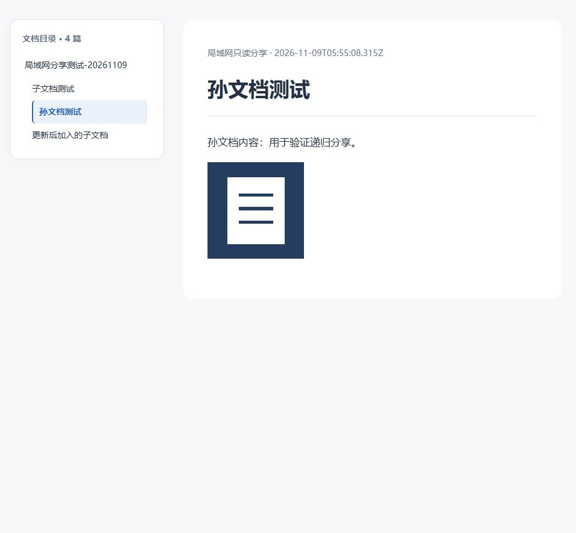

# 思源局域网分享插件

本插件将文档及子文档发布为局域网只读快照。
访客用浏览器阅读，无需登录思源。

安装前需知道三点：

| 条件 | 影响 |
|---|---|
| 使用 Windows 桌面端思源 3.8.9 及以上版本 | 浏览器端和手机端不能启动服务 |
| 分享期间保持思源运行 | 退出思源后，链接无法访问 |
| 链接使用 HTTP，无访问密码 | 持有链接的人能读取快照和附件 |

实机预览展示左侧文档目录与独立正文区域。

## 兼容范围

| 项目 | 当前状态 |
|---|---|
| Windows 思源 3.8.9 | 已完成实机测试 |
| 更高版本 | 尚未逐版测试 |
| macOS、Linux、手机及浏览器管理端 | 当前发布包不声明支持 |
| 局域网跨设备访问 | 尚无第二台设备，未完成实测 |

## 安装

1. 打开思源工作空间目录。
2. 打开 `data/plugins` 目录。
3. 新建 `siyuan-lan-share` 目录。
4. 将安装包解压到该目录。
5. 检查该目录内有 `plugin.json`。
6. 重启思源。
7. 在插件设置中启用“局域网分享”。

源码包中的 `dist` 是安装目录。
安装包内的文件不能再套一层目录。
否则思源无法识别插件。

## 发布

文档正文引用的本地附件会随快照发布。
撤销链接不能删除访客已保存的副本。

1. 保存需要分享的文档。
2. 点击顶栏的“局域网分享”。
3. 点击“启动服务”。
4. 填写文档编号。
5. 如果需整组分享，勾选“包含子文档”。
6. 点击“预览分享范围”。
7. 核对待分享文档清单。
8. 点击“发布此范围”。
9. 复制对应网卡的链接。
10. 在另一台设备中打开链接。

整组分享包含全部层级，也包含隐藏文档。
访客可通过左侧目录切换文档。
宽屏目录吸附在顶部，长目录可独立滚动。
窄屏请点击左上角的目录按钮。
如果清单包含不想公开的笔记，取消发布。

文档编号可从文档菜单复制。
只有一个编辑器时，插件会预填编号。
多个编辑器时，先核对预填编号。

| 操作 | 结果 |
|---|---|
| 预览并更新 | 核对范围后，原链接显示新的整组快照 |
| 新增子文档 | 整组更新后加入分享目录 |
| 删除或移走子文档 | 整组更新后移出分享目录 |
| 撤销整组分享 | 根文档、子文档和附件同时停止读取 |
| 更新时任一文档导出失败 | 保留原分享，不发布部分结果 |
| 更新旧版单篇分享 | 保留单篇范围；勾选后才加入子文档 |
| 停止服务 | 所有链接暂时无法访问 |
| 重启思源 | 保留快照，需要手动启动服务 |

## 访问条件

| 现象 | 处理 |
|---|---|
| 端口被占用 | 停止服务后改用其他端口 |
| 本机能打开，其他设备不能 | 允许防火墙中的思源访问专用网络 |
| 存在多个地址 | 选择与访客设备同一局域网的地址 |
| 无线网络禁止设备互访 | 关闭路由器的客户端隔离或更换网络 |

服务监听本机所有 IPv4 网卡。
不要给此端口配置公网转发。
否则外部持有链接的人也能读取快照。

## 功能范围

| 功能 | 支持情况 |
|---|---|
| 标题、段落、列表、代码、表格 | 支持 Markdown 导出结果 |
| 本地图片、音视频 | 复制到快照并提供读取 |
| 其他本地附件 | 作为下载文件提供 |
| 附件总量 | 每组最多 50 MB，相同路径附件只保存一次 |
| 正文总量 | 每组最多 10 MB，超过后保留原分享 |
| 外链图片、脚本、嵌入网页 | 不加载 |
| 块引用、查询、数据库、公式、脑图 | 不保证保留思源原始效果 |
| 子文档 | 支持全部层级，最多 500 篇、64 层 |
| 目录布局 | 宽于 900 像素时显示左侧目录 |
| 窄屏目录 | 宽度不超过 900 像素时按需展开 |
| 超过文档数或层级限制 | 取消本次发布，请选择更小的文档目录 |
| 自动同步、密码、到期时间 | 未实现 |

插件保存快照，不向访客代理思源接口。
插件不会将思源令牌写入分享页面。
插件数据随思源插件数据存储。
附件会占用额外存储空间。

## 开发与验证

需要 Node.js 18 或更高版本。
项目没有第三方构建依赖。

1. 在源码目录运行 `npm run build`。
2. 运行 `npm test`。
3. 将 `dist` 内容安装到插件目录。

制作集市安装包时，还需要 Python 3。
运行 `npm run package` 可生成 `package.zip`。
`SHA256SUMS` 用于核对安装包文件是否一致。
发布前运行 `npm run check:release`。
如果作者或仓库地址缺失，检查会拒绝发布。

集成测试验证真实 HTTP 服务。
覆盖目录收集、范围隔离、失败保留和旧版兼容。
测试还覆盖整组更新、整组撤销及附件访问。
跨设备访问仍需另一台局域网设备验收。

安装后执行以下验收：

1. 发布含两层子文档和图片的测试目录。
2. 在另一台设备打开链接。
3. 新增子文档并更新整组快照。
4. 检查原链接显示新增子文档。
5. 撤销整组分享。
6. 检查根文档和子文档均无法读取。

## 说明调整

| 删除的原说明 | 原因 |
|---|---|
| 子文档不递归发布 | 0.2.0 已实现整组分享 |
| 点击“发布或更新快照” | 新版先预览范围，再发布 |
| 每份快照最多 50 MB | 新版按整组统计附件总量 |
| 当前交付未完成思源桌面端实机验收 | 旧版已完成发布、更新和图片读取实测 |
| 访客可通过页面中的文档目录切换文档 | 0.2.1 将目录移到左侧并加入吸附 |
| 使用思源桌面端 | 发布包改为只声明已实测的 Windows 环境 |

## 许可证

本项目采用 MIT 许可证，条款见 `LICENSE`。

## 参考资料

- [参考分享项目](https://github.com/terwer/siyuan-plugin-blog)
- [用户提供的开发文档](https://siyuan-note.apifox.cn/7069547m0)
- [官方插件示例](https://github.com/siyuan-note/plugin-sample)
- [官方导出接口实现](https://github.com/siyuan-note/siyuan/blob/master/kernel/api/export.go)

本项目为独立实现，未复制参考项目代码。
